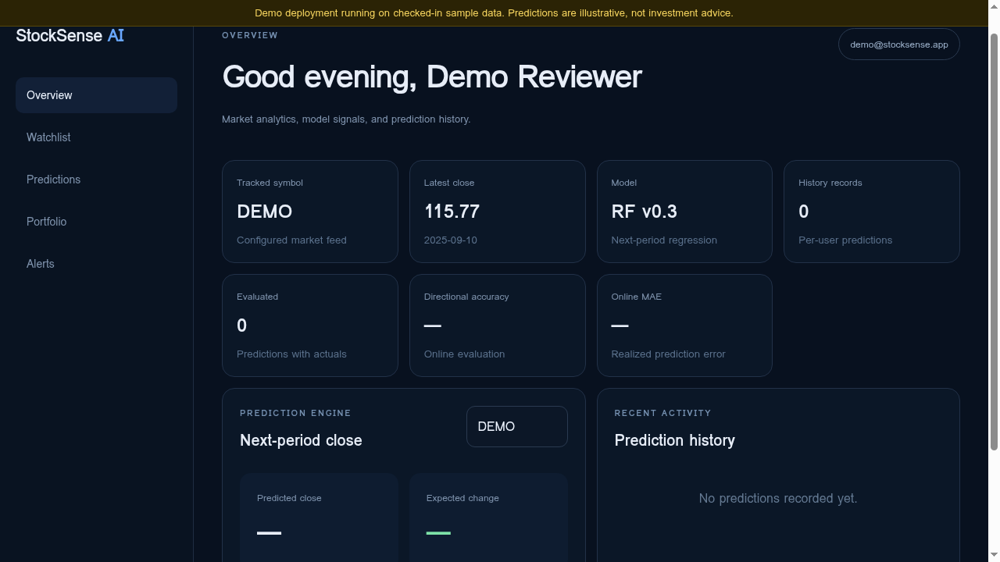
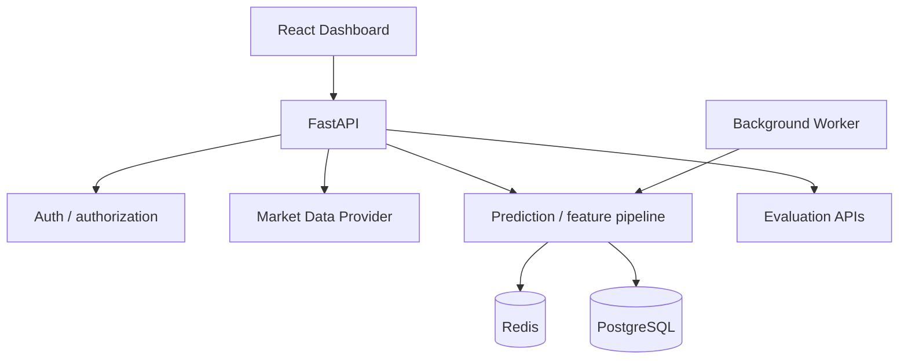

# StockSense AI — Market Intelligence & Evaluation

[](https://github.com/AloneRider-pixel/stocksense-ai/actions/workflows/ci.yml)
[](https://github.com/AloneRider-pixel/stocksense-ai/actions/workflows/codeql.yml)
[](LICENSE)

**Live demo:** [stocksense-ai-demo.onrender.com](https://stocksense-ai-demo.onrender.com) (one-click demo sign-in, no account setup)

StockSense AI makes next-day close predictions for NSE and US stocks, stores every prediction, and scores each one against the real close when it lands.
The point is not the model; it is the evaluation discipline: measured accuracy is always reported next to naive baselines, and nothing is deleted or restated.
Built solo by [Himanshu Bisht](https://github.com/AloneRider-pixel) to demonstrate a production-shaped FastAPI + React system with honest, chronological model evaluation.

**Stack:** FastAPI · PostgreSQL · Redis · scikit-learn · React/Vite · Docker · GitHub Actions

## Live demo

Try the deployed app: [stocksense-ai-demo.onrender.com](https://stocksense-ai-demo.onrender.com)

| | |
|---|---|
| Email | `demo@stocksense.app` |
| Password | `Demo1234!` |



The demo serves real daily market data (Twelve Data for US symbols, Yahoo Finance for NSE; bars may be delayed). The live track record builds as stored predictions are reconciled against real closes. Predictions are illustrative, not investment advice.

## Honest limits

- **Free-tier hosting:** the demo sleeps when idle; first load can take up to a minute while the instance wakes.
- **Demo, not production:** the deployed instance handles demo traffic only; nothing here is load-tested for production use.
- **Backtest assumptions disclosed:** walk-forward out-of-sample, long/flat, no transaction costs, no shorting, no leverage. Past performance does not guarantee future results.
- **Track record starts empty:** a fresh deployment has no scored predictions yet; the accuracy cards fill in as real closes arrive. That is the honest state, not a bug.

## What it demonstrates

- JWT-authenticated accounts with user-scoped prediction history.
- Server-side Twelve Data integration and provider-secret isolation.
- Feature engineering with expanding-window walk-forward evaluation.
- Prediction generation and prediction-vs-actual reconciliation.
- Redis caching/rate limiting, PostgreSQL persistence, and background workers.
- Reproducible sample-data evaluation and evidence verification.
- Public accuracy endpoint and landing-page track record comparing live tracked predictions against last-close persistence and always-up naive baselines.
- Walk-forward backtest view: long/flat model strategy vs buy-and-hold equity curve with max drawdown, assumptions disclosed.

## Architecture



## Stack

| Layer | Technology |
|---|---|
| API | FastAPI, Python |
| Data | PostgreSQL, SQLAlchemy, Alembic |
| Cache / limits | Redis |
| ML | scikit-learn / feature pipeline |
| Market data | Twelve Data |
| Frontend | React, Vite |
| Delivery | Docker, GitHub Actions |

## Evaluation contract

Evaluation is chronological: each prediction period is restricted to information available before that period. Sample-fixture results are reproducibility evidence, not universal or production performance claims.

A credible model-quality claim should include:
- a representative dataset and provenance;
- leakage controls and temporal boundaries;
- a baseline comparison;
- the metric definition and sample count;
- the environment/model version; and
- the producing commit or experiment artifact.

## Quick start

Backend:

```bash
python -m venv .venv
source .venv/bin/activate
pip install -r requirements.txt
cp .env.example .env
alembic upgrade head
uvicorn app.main:app --reload
```

Frontend:

```bash
cd frontend
npm install
npm run dev
```

Full stack (local development only):

```bash
docker compose up --build
```

The sample values in `.env.example` and `docker-compose.yml` are development-only. The full-stack Compose ports bind to localhost, and production mode rejects placeholder JWT secrets, weak or local database URLs, unsecured Redis URLs, wildcard/local hosts, invalid database URLs, and non-HTTPS or wildcard CORS origins. See [the deployment guide](docs/deployment.md) before configuring production services.

## Verification

```bash
make lint
make test
make build-frontend
python scripts/verify_sample_evidence.py
```

For the deterministic sample pipeline:

```bash
python -m app.services.training --data-path data/sample_prices.csv --limit 1000 --model-version ci-sample-v1
```

## Security

Passwords are hashed, protected endpoints are user-scoped, provider secrets remain server-side, request validation is enforced, and Redis-backed rate limits protect API paths.

See [docs/security.md](docs/security.md), [docs/deployment.md](docs/deployment.md), and [SECURITY.md](SECURITY.md).

## Limitations

Predictions are informational and are not investment advice. Backtest results can fail to generalize. Avoid presenting sample fixtures or historical simulations as guarantees of future market behavior.

## Documentation

- [Architecture](docs/architecture.md)
- [Model evaluation](docs/model-evaluation.md)
- [Testing](docs/testing.md)
- [Security](docs/security.md)
- [Operations](docs/operations.md)
- [Deployment](docs/deployment.md)
- [Engineering decisions](docs/engineering-decisions.md)

## Contribution standard

Preserve chronological evaluation boundaries, user-data isolation, provider-secret separation, deterministic evidence, and rate limiting. Behavioral changes should add or update regression tests.

## License

MIT
