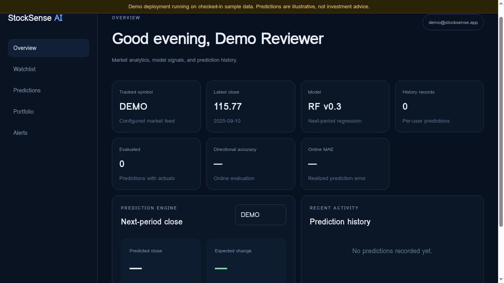
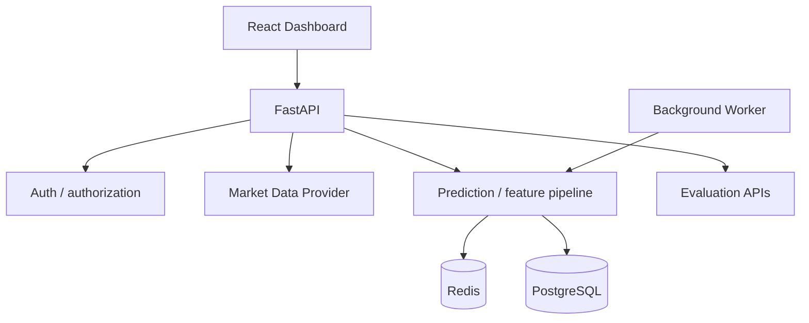

# StockSense AI — Market Intelligence & Evaluation

[](https://github.com/AloneRider-pixel/stocksense-ai/actions/workflows/ci.yml)
[](https://github.com/AloneRider-pixel/stocksense-ai/actions/workflows/codeql.yml)
[](https://github.com/AloneRider-pixel/stocksense-ai/actions/workflows/ci.yml)
[](LICENSE)

**Live demo:** [stocksense-ai-demo.onrender.com](https://stocksense-ai-demo.onrender.com) (one-click demo sign-in, no account setup)

StockSense AI is an India-first model-evaluation sandbox: it makes next-trading-day close forecasts for the NIFTY 50 universe (NSE equities), precious metals (spot gold and silver), and INR currency pairs (USD/INR, EUR/INR, GBP/INR), stores every forecast, and scores each one against the real close when it lands.
The point is not the model; it is the evaluation discipline: measured error is always reported next to naive baselines (last-close persistence) and the NIFTY 50 index over the same windows, and nothing is deleted or restated.
Built solo by [Himanshu Bisht](https://github.com/AloneRider-pixel) to demonstrate a production-shaped FastAPI + React system with honest, chronological model evaluation.

**Research and engineering project. Not investment advice. Not a SEBI-registered research analyst or investment adviser. Past model performance does not indicate future results. Do not trade on this.**

**Stack:** FastAPI · PostgreSQL · Redis · scikit-learn · React/Vite · Docker · GitHub Actions

**API:** [endpoint guide with real examples](docs/api.md)

## Try it in 2 minutes

1. Open the [live demo](https://stocksense-ai-demo.onrender.com). First load can take up to a minute on free-tier hosting.
2. Click **Live dashboard** - one click signs you into the shared demo account.
3. Pick an instrument pill (NIFTY 50 stock, gold, silver, or an INR pair) and press **Run prediction**, or open **Backtest** to see the model strategy vs buy-and-hold on real stored bars.
4. Check the landing-page track record: every prediction is stored and scored against the real close, next to naive baselines.

## Live demo

Try the deployed app: [stocksense-ai-demo.onrender.com](https://stocksense-ai-demo.onrender.com)

| | |
|---|---|
| Email | `demo@stocksense.app` |
| Password | `Demo1234!` |



The demo serves real daily market data (Yahoo Finance for NSE equities, the NIFTY 50 index, metals, and FX; Twelve Data for optional US symbols; bars may be delayed). Metals are USD spot indications, not MCX futures. FX rates are indicative interbank levels, not executable prices. The live track record builds as stored forecasts are reconciled against real closes.

## Honest limits

- **Paper trading is a simulation:** fills use stored daily closes, not live quotes; there is no slippage, liquidity, or intraday execution model. It is practice software, not a trading system.
- **Alerts are not real-time:** they evaluate only when new daily bars are ingested and only on close-to-close crossings. They can fire late or not at all if ingestion stalls, and they are not investment advice.

- **Free-tier hosting:** the demo sleeps when idle; first load can take up to a minute while the instance wakes.
- **Demo, not production:** the deployed instance handles demo traffic only; nothing here is load-tested for production use.
- **Backtest assumptions disclosed:** walk-forward out-of-sample, long/flat, no transaction costs, no shorting, no leverage. Past performance does not guarantee future results.
- **Track record starts empty:** a fresh deployment has no scored predictions yet; the accuracy cards fill in as real closes arrive. That is the honest state, not a bug.

## What it demonstrates

- JWT-authenticated accounts with user-scoped prediction history.
- Server-side Twelve Data integration and provider-secret isolation.
- Feature engineering with expanding-window walk-forward evaluation.
- Prediction generation and prediction-vs-actual reconciliation.
- Redis caching/rate limiting, PostgreSQL persistence, and background workers.
- Reproducible sample-data evaluation and evidence verification.
- India-first instrument registry: NIFTY 50 constituents, the NIFTY 50 index, spot gold/silver, and USD/INR, EUR/INR, GBP/INR pairs (INR, Asia/Kolkata, NSE holiday calendar).
- Public accuracy endpoint and landing-page track record comparing live tracked forecasts against last-close persistence and the NIFTY 50 index over the same windows.
- Walk-forward backtest view: long/flat model strategy vs buy-and-hold equity curve with max drawdown, assumptions disclosed.
- Paper-trading wallet (simulated only): virtual INR cash, market orders filled at stored daily closes, positions with weighted-average cost, realized/unrealized P&L, and rejection codes for stale or missing prices. No real money, no broker, no live quotes.
- Price alerts (simulated): crossing rules on stored daily closes with in-app notifications; no backfill of pre-existing history, no duplicate notifications on repeated or concurrent ingestion.

## Paper trading and alerts (simulated)

Two practice features run entirely on stored, possibly delayed daily bars. Neither routes real money, connects to a broker, or fetches live quotes.

**Paper wallet.** Every account starts with virtual ₹10,00,000. Market orders fill at the symbol's latest stored close; orders are rejected with explicit reason codes when there is no stored price (`NO_STORED_PRICE`), the stored price is stale relative to the NIFTY 50 universe (`STALE_PRICE`), or funds/holdings are insufficient. Positions track weighted-average cost; the wallet reports cash, market value, equity, and realized/unrealized P&L. Reset restores the virtual cash and clears the simulated history.

**Price alerts.** A rule fires when the latest stored close crosses the target in the chosen direction (above or below) relative to the previous stored close. Creating a rule pins its baseline to the latest stored bar, so history already past the target never fires as a "new" crossing. Each bar date can fire a rule at most once, even under repeated or concurrent ingestion; a fired rule stays active and re-arms for the next crossing on a newer bar. Alerts are evaluated in the background worker right after ingestion; evaluation failures are retried by the job queue rather than silently dropped.

**Delivery is in-app only.** Fired alerts appear under the notification bell. The notifier seam currently logs only - no email is sent to anyone. External delivery would be a separate, explicitly approved change.

## Architecture



## Stack

| Layer | Technology |
|---|---|
| API | FastAPI, Python |
| Data | PostgreSQL, SQLAlchemy, Alembic |
| Cache / limits | Redis |
| ML | scikit-learn / feature pipeline |
| Market data | Twelve Data |
| Frontend | React, Vite |
| Delivery | Docker, GitHub Actions |

## Evaluation contract

Evaluation is chronological: each prediction period is restricted to information available before that period. Sample-fixture results are reproducibility evidence, not universal or production performance claims.

A credible model-quality claim should include:
- a representative dataset and provenance;
- leakage controls and temporal boundaries;
- a baseline comparison;
- the metric definition and sample count;
- the environment/model version; and
- the producing commit or experiment artifact.

## Verified results

Measured at commit `8bbd89a` (Python 3.12). Commands are in [Verification](#verification).

**Test suite**
- 241 passed, 23 skipped (PostgreSQL-gated integration tests), 0 failed, ~24 seconds.
- Local coverage without the PostgreSQL-gated paths: 83% of 3,230 statements. CI provisions PostgreSQL and enforces >=85% coverage.

**Sample benchmark** (deterministic fixture - reproducibility evidence, not live forecast accuracy or financial performance)
- Dataset: `data/sample_prices.csv` (sha256-pinned, 180 rows; 140 scored rows across 5 walk-forward folds).
- Model: `ci-sample-v1`, produced by `python -m app.services.training --data-path data/sample_prices.csv --limit 1000 --model-version ci-sample-v1`.
- MAE 0.1654, RMSE 0.2074, directional accuracy 85.0%; last-close baseline MAE 0.2995 (44.8% improvement over the baseline).
- `python scripts/verify_sample_evidence.py` re-verifies the stored evidence artifact.

## Quick start

Backend:

```bash
python -m venv .venv
source .venv/bin/activate
pip install -r requirements.txt
cp .env.example .env
python -m app.db.migrate   # gated startup migration; bare `alembic upgrade head` also works for local dev
uvicorn app.main:app --reload
```

Frontend:

```bash
cd frontend
npm install
npm run dev
```

Full stack (local development only):

```bash
docker compose up --build
```

The sample values in `.env.example` and `docker-compose.yml` are development-only. The full-stack Compose ports bind to localhost, and production mode rejects placeholder JWT secrets, weak or local database URLs, unsecured Redis URLs, wildcard/local hosts, invalid database URLs, and non-HTTPS or wildcard CORS origins. See [the deployment guide](docs/deployment.md) before configuring production services.

## Verification

```bash
make lint
make test
make build-frontend
python scripts/verify_sample_evidence.py
```

For the deterministic sample pipeline:

```bash
python -m app.services.training --data-path data/sample_prices.csv --limit 1000 --model-version ci-sample-v1
```

## Security

Passwords are hashed, protected endpoints are user-scoped, provider secrets remain server-side, request validation is enforced, and Redis-backed rate limits protect API paths.

See [docs/security.md](docs/security.md), [docs/deployment.md](docs/deployment.md), and [SECURITY.md](SECURITY.md).

## Limitations

Forecasts are informational and are not investment advice. Backtest results can fail to generalize. Avoid presenting sample fixtures or historical simulations as guarantees of future market behavior.

- **NIFTY 50 universe is a snapshot:** index membership changes; the registry in `app/market_data/symbols.py` is the source of truth and can be refreshed.
- **Metals are spot, not MCX:** gold and silver are delayed USD spot indications from Yahoo Finance, not Indian exchange-traded contracts.
- **FX is indicative:** currency pairs are delayed interbank indications, not executable prices.
- **Data may be delayed:** providers used for the demo do not guarantee real-time or error-free data.

## Regulatory note

This is a personal research and engineering project. It is not investment advice, research-analyst output, or a recommendation to buy or sell any security, commodity, or currency. The operator is not a SEBI-registered research analyst or investment adviser. Past model performance does not indicate future results. Do not trade on this.

## Documentation

- [Architecture](docs/architecture.md)
- [Model evaluation](docs/model-evaluation.md)
- [Testing](docs/testing.md)
- [Security](docs/security.md)
- [Operations](docs/operations.md)
- [Deployment](docs/deployment.md)
- [Engineering decisions](docs/engineering-decisions.md)

## Contribution standard

Preserve chronological evaluation boundaries, user-data isolation, provider-secret separation, deterministic evidence, and rate limiting. Behavioral changes should add or update regression tests.

## License

MIT
